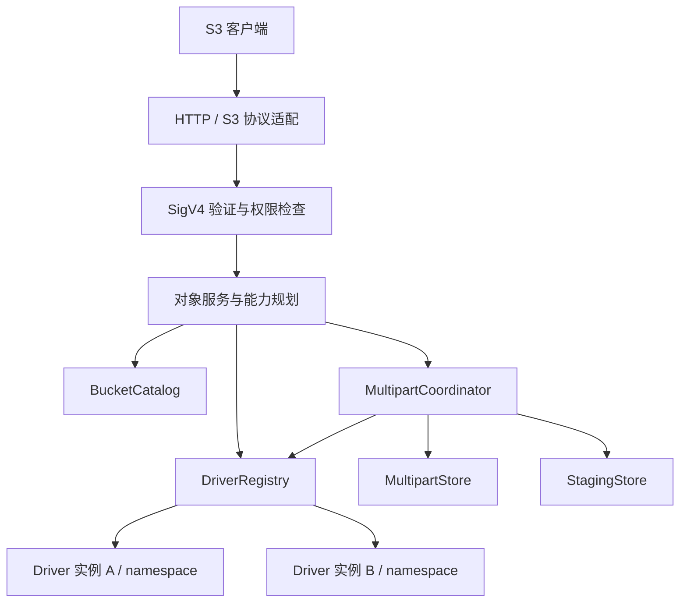

# 多 driver S3 服务器实现规范

状态：P0–P5 已实现，并以 boto3 / AWS CLI 对运行中的服务做过端到端验证；P6（生产后端准入、持久性）未开始。更新日期：2026-09-25。

本文约定 `allins3` 的架构、接口和可验证行为；开发顺序见[实现计划](implementation-plan.md)。当前实现已覆盖 HTTP/S3 适配与 SigV4 认证、单 crate 的模块边界、driver 接口与能力模型、内存测试 driver、以及服务层 multipart 协调器；**生产存储后端与持久性声明仍不在范围内**（见 P6 与 `INV-10`）。

已确定的方向：**先定义通用 driver 接口，暂不限定具体生产存储后端**。下文的参考 driver、故障 driver 和内存状态存储均为测试工具，不代表生产后端选型。

## 1. 目标与边界

### 1.1 第一阶段目标

1. 对外提供有明确兼容范围的 S3 HTTP 服务，可由 AWS CLI 和常用 SDK 访问。
2. 同一服务可以注册多个 driver 类型、创建多个 driver 实例，并按 bucket 路由。
3. driver 接口独立于 HTTP、S3 SDK 和具体存储产品；新增 driver 不修改协议处理逻辑。
4. 支持流式读写、对象原子发布、可声明的可选能力，以及统一的错误与取消语义。
5. 提供可重复运行的 driver 契约测试、协议测试和兼容性报告。

首期部署模型是单个服务进程。接口设计保留共享状态与多实例部署的扩展点，但首期不承诺分布式协调或高可用。

### 1.2 暂不包含

- 选定或实现特定生产后端。
- 一个 bucket 同时跨多个 driver 分片、合并列举、双写、故障切换或在线迁移。
- S3 Versioning、Object Lock、ACL、完整 IAM/Bucket Policy、STS、SigV2、SigV4a。
- SSE-S3/SSE-KMS/SSE-C、生命周期、通知、复制、网站托管、Select、Directory Buckets。
- 动态加载 `.so`/`.dll` 的 Rust 插件 ABI；首期采用编译期注册、运行期配置实例。
- S3 `CreateBucket` / `DeleteBucket`；首期 bucket 由配置预先绑定已有 namespace。

不支持的功能必须明确失败。不得忽略版本、加密、权限、标签等具有业务含义的参数后返回成功。

### 1.3 规范用语与兼容档位

“必须”是验收条件；“应”允许有记录的理由与替代方案；“可”是可选扩展。

| 档位 | 必需能力 | 用途 |
| --- | --- | --- |
| `core-read` | HEAD、稳定对象读取、有序列举、元数据读取 | 只读 namespace |
| `core-write` | `core-read` + 隐藏暂存、原子提交、原子删除、写后强一致 | 可写 namespace |
| `multipart` 扩展 | `core-write` + 满足第 8 节的分片能力与状态管理 | 分片上传 |

Range、条件写、原生复制等通过能力表额外声明。只有实际通过测试的“操作 + 参数 + driver 配置”组合才可以标为兼容；不得将上述档位宣传为完整 AWS S3。

## 2. 架构与职责



| 组件 | 负责 | 不应承担 |
| --- | --- | --- |
| 协议适配 | 路由、XML、HTTP 头、签名原始输入、S3 错误编码 | 后端路径规则、存储产品判断 |
| 认证与授权 | 凭据解析、SigV4、principal、bucket/action/prefix 权限 | 使用客户端密钥连接后端 |
| 对象服务 | 参数语义、能力选择、校验、复制回退、限流、请求生命周期 | 根据 driver 名称写特殊分支 |
| BucketCatalog | bucket 名称、所有者、region、binding、配置版本 | 对象内容与对象元数据的第二份权威副本 |
| DriverRegistry | 工厂注册、实例初始化、配置检查、健康状态 | S3 权限判断 |
| driver | namespace 隔离、对象内容与元数据一致性、后端错误转换 | XML、HTTP 状态码、SigV4 |
| MultipartCoordinator | upload 生命周期、并发仲裁、完成与清理 | 默认依赖某一种数据库或文件系统 |
| 状态/暂存接口 | 持久性声明、CAS、临时数据访问与回收 | 冒充生产级持久化实现 |

技术基线采用现有 Rust 项目；异步 trait 统一使用 `async-trait`，异步运行时、HTTP、序列化等依赖在 P0 选型验证后固定。优先评估 `s3s` 作为协议适配候选，但保持封装边界。其官方项目明确将其定位为实验性适配器，请求大小、限流和背压需要应用实现，不能因采用它就跳过这些工作。[s3s 官方仓库](https://github.com/s3s-project/s3s)

### 2.1 三个不同概念

- `DriverKind`：某一种适配实现的注册名。
- `DriverInstanceId`：该实现的一份配置与连接资源；相同 kind 可有多个实例。
- `NamespaceId`：实例内的隔离空间，对核心层是不透明标识，不预设为目录、bucket 或数据库表。

绑定关系固定为 `BucketId -> (DriverInstanceId, NamespaceId, BindingGeneration)`。逻辑 bucket 名称不必等于后端 namespace 名称。

首期拒绝两个可写 bucket 绑定同一 namespace；允许别名会影响权限、一致性和列举，需另行设计。driver 必须检查自己可识别的 namespace 别名或包含关系；部署文档必须声明无法自动检测的外部别名约束。

每个请求、分页令牌和 upload 固定绑定版本。bucket/instance/namespace 的 ID 和 binding generation 必须显式配置或稳定保存，普通重启不能随机生成新值。首期不支持热切换 binding；配置变更须停服、排空请求并处理未完成 upload。删除配置项不是删除后端数据。

### 2.2 状态所有权

对象字节、长度、ETag、checksum、用户元数据和内部 revision 必须由同一个逻辑提交协议管理。driver 可以内部组合“数据存储 + 元数据索引”，但必须自行实现并证明其一致性；核心层不能先写字节、再独立写一条元数据记录并把两次成功当成原子成功。

`BucketCatalog` 首期可以从只读配置加载。`MultipartStore` 与 `StagingStore` 是独立接口，具体持久化实现待后端选择时确定。引用任意外部数据库或远端服务都不是本规范的默认前提。

## 3. 数据模型与 driver 接口

### 3.1 核心类型

| 类型 | 必须包含或满足的语义 |
| --- | --- |
| `BucketId` / `DriverInstanceId` / `NamespaceId` | 强类型包装，避免误传原始字符串 |
| `ObjectKey` | 验证后的 UTF-8 key；与本地路径类型分离 |
| `ObjectMetadata` | key、size、ETag、Last-Modified、HTTP 内容属性、用户元数据、可用 checksum、内部 revision |
| `ObjectRevision` | driver 内部不透明修订标识，绑定同一份内容与元数据；不是 ETag 或 S3 versionId |
| `ReadRequest` | key、必须匹配的 expected_revision、可选已解析字节范围；先根据 stat 结果判断条件再构造，不包含 HTTP 请求对象 |
| `ReadResult` | 与 expected_revision 完全一致的 metadata 和有背压的数据流；读取期间覆盖 key 不得改变其内容 |
| `ResolvedRange` | 根据已检查 revision 的对象长度计算出的有效区间；原始 Range 的可满足性由服务层在条件判断后检查 |
| `ListRequest` | prefix、delimiter、start_after 或 driver cursor、limit；互斥关系由类型/验证保证 |
| `ListPage` | 有序对象与 common prefix、opaque cursor、是否结束 |
| `BeginWrite` | key、可选预期长度、预条件、写入标识、对象内容属性与用户元数据 |
| `CommitAttributes` | 实际长度、最终 ETag、已验证 checksum、必要的完成信息 |
| `WriteId` / `CommitState` | 单次提交尝试的不可复用标识，以及已提交、终态未提交、执行中或未知状态；作用域包含绑定的 namespace |
| `DriverContext` | request_id、deadline、取消信号、trace 上下文；不含客户端密钥 |
| `DriverError` | 稳定错误种类、提交结果确定性、安全摘要、内部 cause、重试提示 |

`ObjectRevision` 必须能区分元数据更新；即使 ETag 相同也不能被当作同一个内部 revision。`stat` 返回的 revision 必须作为后续 `read` 的必填条件；driver 不能读取该 revision 时返回内部 `RevisionUnavailable`，不得退回按 key 读取当前对象。该错误的处理顺序见第 5.3 节。

### 3.2 接口形状

以下是约束接口方向的 Rust 签名示意，省略领域类型定义，并非当前已经存在的可编译模块。异步方法使用 `#[async_trait]` 与 `async fn`；正式实现必须提供 rustdoc、完整类型和编译检查。

```rust
use std::sync::Arc;

use async_trait::async_trait;
use bytes::Bytes;

#[async_trait]
pub trait StorageDriver: Send + Sync {
    fn descriptor(&self) -> DriverDescriptor;

    async fn health(&self, ctx: &DriverContext) -> Result<DriverHealth, DriverError>;
    async fn shutdown(&self, ctx: &DriverContext) -> Result<(), DriverError>;

    async fn open_namespace(
        &self,
        ctx: &DriverContext,
        namespace: &NamespaceId,
    ) -> Result<NamespaceHandle, DriverError>;
}

pub struct NamespaceHandle {
    pub capabilities: NamespaceCapabilities,
    pub read: Arc<dyn ReadNamespace>,
    pub write: Option<Arc<dyn WriteNamespace>>,
    pub multipart: Option<Arc<dyn MultipartNamespace>>,
    pub native_copy: Option<Arc<dyn NativeCopy>>,
    pub recovery: Option<Arc<dyn CommitRecovery>>,
}

pub struct ReadRequest {
    pub key: ObjectKey,
    pub expected_revision: ObjectRevision,
    pub range: Option<ResolvedRange>,
}

pub enum CommitState {
    Committed,
    NotCommittedFinal,
    InFlight,
    Unknown,
}

#[async_trait]
pub trait CommitRecovery: Send + Sync {
    async fn query(
        &self,
        ctx: &DriverContext,
        write_id: &WriteId,
    ) -> Result<CommitState, DriverError>;
}

#[async_trait]
pub trait ReadNamespace: Send + Sync {
    async fn stat(
        &self,
        ctx: &DriverContext,
        key: &ObjectKey,
    ) -> Result<ObjectMetadata, DriverError>;
    async fn read(&self, ctx: &DriverContext, req: ReadRequest)
        -> Result<ReadResult, DriverError>;
    async fn list(&self, ctx: &DriverContext, req: ListRequest)
        -> Result<ListPage, DriverError>;
}

#[async_trait]
pub trait WriteNamespace: Send + Sync {
    async fn begin_write(
        &self,
        ctx: &DriverContext,
        req: BeginWrite,
    ) -> Result<Box<dyn StagedWrite>, DriverError>;
    async fn delete(&self, ctx: &DriverContext, req: DeleteRequest)
        -> Result<DeleteResult, DriverError>;
}

#[async_trait]
pub trait StagedWrite: Send {
    async fn write_chunk(&mut self, ctx: &DriverContext, bytes: Bytes)
        -> Result<(), DriverError>;
    async fn commit(
        self: Box<Self>,
        ctx: DriverContext,
        attrs: CommitAttributes,
    ) -> Result<ObjectMetadata, DriverError>;
    async fn abort(self: Box<Self>, ctx: DriverContext) -> Result<(), DriverError>;
}
```

约束：

1. 公共异步 trait 及其实现统一标注 `#[async_trait]`，方法返回 `Result<T, DriverError>`。共享接口通过 `Arc<dyn Trait>` 使用，staged write 通过 `Box<dyn StagedWrite>` 独占并消费；保持动态分发能力。
2. 数据流采用 `Bytes` 与 `Stream<Item = Result<Bytes, DriverError>>` 或等价抽象，禁止以整个对象的 `Vec<u8>` 作为生产接口。
3. 每个 namespace handle 已经绑定隔离空间；方法不再接收可任意替换的 backend bucket/path。
4. 必需方法没有假成功的默认实现；可选接口不存在时必须与能力声明一致。
5. 工厂负责验证 driver 私有配置；核心层只理解公共字段、kind、实例 ID 和能力。
6. 可选接口遵循第 3.4 节的方法契约，具体 Rust 类型签名在 P1 固化，不能成为未约束的 SDK 透传入口。
7. 请求 future 被取消不等于后端操作必然回滚；结果与清理规则见第 5、9 节。
8. 使用 `async-trait` 默认的 `Send` future，不使用 `#[async_trait(?Send)]`；`DriverContext` 必须满足 `Send + Sync`，跨 await 的数据也须满足相应约束。`StagedWrite` 采用独占可变访问，仅要求 `Send`。

`async-trait` 负责异步方法的 future 类型擦除；trait 定义和对应 `impl` 都需要该宏。[async-trait 官方文档](https://docs.rs/async-trait/latest/async_trait/)

### 3.3 能力与约束必须分开声明

driver 声明原生能力和语义属性；服务层根据已注册的补齐实现计算 `Native / Emulated / Unsupported`。不得由 driver 仅填一个 `supports_s3 = true`。

| 项目 | 必须声明的内容 | 允许的服务层补齐 |
| --- | --- | --- |
| 基础读 | stat 返回 revision；read 必须匹配该 revision，metadata 与数据同 revision | 不允许靠两次无关联读取补齐；revision 不可读时重走完整条件判断 |
| 列举 | 有序结果、prefix/delimiter、游标语义、写后可见性 | 有序原始扫描上的流式分组；无序全量排序不作默认回退 |
| 原子写 | 暂存不可见、发布线性化点、成功后的持久性 | 须有独立适配器和可证明的提交协议 |
| Range | 原生支持的范围形式与读取代价 | 显式启用、有扫描上限的稳定流裁剪 |
| 条件写/删 | 原子条件判断、支持的条件种类 | 不允许先 HEAD 后无条件修改 |
| 复制 | 适用实例/namespace 范围、源 revision 约束 | 稳定读流接目标 staged write |
| Multipart | native 接口或服务层 coordinator 所需能力 | `MultipartStore + StagingStore + staged write` |
| 限制 | 最大对象/单次写/part、元数据、连接数、重试条件 | 最终限制取协议、服务配置、driver 的交集 |
| 一致性与持久性 | 强/弱一致、进程退出后的持久性、是否允许外部写入 | 不能用缓存或进程锁把弱一致宣称为强一致 |

启动时校验 bucket 档位需要的能力。原生与补齐均不可用时拒绝该配置，而不是运行中静默减少档位的必需能力。额外请求了未启用的可选能力则返回明确的 S3 错误。

运行中后端不可用不等于能力消失，应返回临时错误；同一配置的能力不应随健康检查随机改变。

### 3.4 扩展接口的方法契约

所有扩展接口及状态存储接口的异步方法同样采用 `#[async_trait]` 与 `async fn`，沿用 `DriverContext`、统一错误和取消语义；输入/输出只能使用领域类型。

| 接口/方法 | 输入与输出 | 不可省略的语义 |
| --- | --- | --- |
| `DriverFactory::validate/create` | kind 私有配置与 secret resolver → 校验结果/driver 实例 | 不能在校验阶段写用户数据；失败须释放已分配连接 |
| `StorageDriver::health/shutdown` | deadline → 状态/关闭结果 | 健康探测不修改用户对象；shutdown 等待内部任务并报告未决状态 |
| `NativeCopy::copy` | 源 namespace 身份与 revision、目标 key、条件、metadata 指令 → 已提交 metadata | 只接受 registry 解析的引用；不接受任意 URL；结果具备原子发布语义 |
| `MultipartNamespace::create` | key、metadata、checksum 方案 → opaque upload handle | 不能修改现有目标对象；handle 绑定 namespace |
| `MultipartNamespace::begin_part` | upload handle、part number、预期长度 → staged part | staged part 的 write/commit/abort 与 staged write 等价，校验前不能替换有效 part |
| `MultipartNamespace::list_parts/list_uploads` | upload/namespace、对应 marker、limit → 有序页 | 只返回本 namespace 的有效状态，并正确实现 S3 marker |
| `MultipartNamespace::complete` | upload handle、固定清单、最终 checksum、写条件 → 已提交 metadata | 原子完成，支持结果未知分类；不得在最终校验前发布 |
| `MultipartNamespace::abort` | upload handle → 终止结果 | 与在途 part/Complete 仲裁，资源最终回收 |
| `CommitRecovery::query`（可选） | 绑定 namespace 内的 write_id → `CommitState` | `NotCommittedFinal` 必须保证原尝试以后也不能发布；无记录不等于终态未提交，完整规则见第 9.2 节 |

driver 负责自己 staged write 的临时资源登记、恢复与后台回收；服务层负责 multipart coordinator 的状态记录。`CommitRecovery` 的可用性必须在 namespace 能力与句柄中显式关联。原生 multipart 无法满足校验、恢复或并发契约时，必须使用可证明等价的通用实现，或不启用该扩展。

## 4. S3 协议范围

### 4.1 操作矩阵

以下是开发目标，不表示已经实现。基础闭环在 P3 交付，multipart 扩展在 P4 交付。

| 操作 | 目标 | 关键条件 |
| --- | --- | --- |
| `ListBuckets` | P3 | 只返回当前 principal 有权限看到的配置 bucket |
| `HeadBucket` / `GetBucketLocation` | P3 | 使用逻辑 catalog 的存在性、权限与 region |
| `HeadObject` / `GetObject` | P3 | 内容属性、用户元数据、条件读；Range 受有效能力约束 |
| `PutObject` | P3 | `core-write`；流式完整性验证与原子发布 |
| `DeleteObject` | P3 | 不存在对象也成功；不提供跨对象事务 |
| `DeleteObjects` | P3 | 单批至多 1,000 个 key，逐项授权与结果、quiet 模式 |
| `ListObjectsV2` | P3 | prefix、delimiter、分页、start-after、encoding-type=url |
| `CopyObject` | P3 | 同/跨 driver；源读权限和目标写权限都必须满足 |
| `CreateMultipartUpload` / `UploadPart` | P4 | bucket 开启 multipart 能力 |
| `ListParts` / `ListMultipartUploads` | P4 | 分页与权限隔离 |
| `CompleteMultipartUpload` / `AbortMultipartUpload` | P4 | 原子完成、竞争处理与回收 |
| `UploadPartCopy` | P4 | 稳定源读取与范围校验，可走流式回退 |
| 条件写/条件删 | P3 可选扩展 | 必须有原子实现；细分操作/条件声明 |
| `ListObjects` v1、浏览器 POST、CORS 配置 | 后续 | 不作为首期兼容声明的一部分 |
| `CreateBucket` / `DeleteBucket` | 后续 | 必须先定义 namespace provisioning 和删除策略 |

`DeleteObjects` 的部分失败放在逐项结果中，不能整批假成功；请求 XML 或完整性校验失败则整批拒绝。普通 bucket 的批量删除须验证官方要求的请求体校验字段。[DeleteObjects](https://docs.aws.amazon.com/AmazonS3/latest/API/API_DeleteObjects.html)

### 4.2 路由、key 和编码

- 首期支持 path-style；virtual-hosted-style 是显式开启的配置能力，并测试 Host、域名后缀、端口和带点 bucket 名。
- 在签名验证前保留原始 URI、query 与 Host。HTTP 路由器、代理不得擅自合并 `//`、解析点段或重复 URL 解码。
- `ObjectKey` 按 UTF-8 字节计长，范围为 1–1,024 字节；`a`、`a/`、`a//b` 是不同 key。`+` 不自动变为空格。
- S3 是扁平对象空间；末尾 `/` 是普通 key，不自动创建目录。文件系统型 driver 若后续实现，须在适配层完成安全映射与别名冲突处理。
- XML 特殊字符必须正确转义；列举的 `encoding-type=url` 与复制源的编码单独处理。覆盖 `%2F`、`%252F`、非 ASCII、换行和控制字符测试。

key 规则与禁止 S3 URI 规范化的依据：[对象 key](https://docs.aws.amazon.com/AmazonS3/latest/userguide/object-keys.html)、[SigV4 canonical request](https://docs.aws.amazon.com/AmazonS3/latest/developerguide/sig-v4-header-based-auth.html)。列举结果包含 XML 1.0 不可表示的字符时，要求 `encoding-type=url`；未请求编码则返回 `InvalidRequest` 并提示使用 URL 编码。此项作为明确的兼容差异记录，不能输出破损 XML 或改写原 key。

### 4.3 列举与分页

通用 bucket 按 key 的 UTF-8 字节字典序输出。对象和折叠后的 common prefix 共同占用 `max-keys` 配额；默认上限 1,000；`max-keys=0` 返回空页，不进行全量扫描。[ListObjectsV2](https://docs.aws.amazon.com/AmazonS3/latest/API/API_ListObjectsV2.html)

本项目规定：有效 continuation token 决定续页位置，`start-after` 只控制没有 token 的首次请求；token 无效时不得退回 `start-after` 悄悄重扫。对应组合须纳入 SDK paginator 验收。

客户端 token 必须版本化、防篡改，并绑定 bucket、binding generation、prefix、delimiter、encoding、鉴权作用域与 driver cursor；使用认证加密或服务端句柄，避免暴露后端路径/凭据。每次续页仍重新鉴权，不能把 token 当权限凭据。密钥轮换与过期时间须配置化。

必须满足：静态数据集全量翻页不漏项、不重复；common prefix 不能跨页重复；伪造、跨 bucket 或配置过期 token 返回 `InvalidArgument`。`ListParts`、`ListMultipartUploads` 使用其各自的 S3 marker 语义，不能直接替换成 V2 continuation token。

一次列举需要满足声明的一致性；跨多次分页不承诺全局快照。并发插入/删除时的游标行为必须记录，但不能因此返回暂存对象或破坏排序。

## 5. 对象写入、读取与一致性

### 5.1 写入状态机

```text
Created -> Receiving -> Validated -> Committing -> Committed
    \          \            \            \
     +----------+------------+             +-> OutcomeUnknown
                |
             Aborting -> Aborted
```

1. 完成身份、权限、路由、参数和能力检查后，才创建 staged write。
2. 对象服务逐块解码和验证 payload，并等待 driver 消费，形成背压。
3. 到达 EOF 后验证实际长度、payload hash、Content-MD5、checksum 与 trailer；失败必须 abort。
4. `commit` 是唯一发布入口，必须把完整对象及其元数据作为一个 revision 发布。
5. 返回成功前必须满足声明的持久性；只进入缓存/队列不算生产写入成功。
6. commit 前失败：新 key 不存在，旧 key 保持原样。commit 已开始后断连：使用 `CommitState` 记录结果；只有保证原尝试以后也不可能发布时，才能标记 `NotCommittedFinal`，不能因超时或取消假定回滚。
7. drop 不能保证异步清理。必须有显式 abort、临时数据登记/租约及可恢复的清理机制；清理不可删除结果未知的已发布对象。

S3 成功写入不应留下部分对象；单 key 读写应看到旧版本或新版本的完整数据。[PutObject](https://docs.aws.amazon.com/AmazonS3/latest/API/API_PutObject.html)、[S3 一致性模型](https://docs.aws.amazon.com/AmazonS3/latest/userguide/Welcome.html)

### 5.2 并发与外部写入

- 无条件并发写按实际提交顺序决胜，不承诺按请求开始时间排序。
- `If-Match` / `If-None-Match` 必须与提交在同一原子操作中判断；先查再写不合格。
- 原子条件不满足返回 `412 PreconditionFailed`；已识别的条件操作竞争按对应 S3 操作映射冲突，不能统一重试覆盖。[条件写](https://docs.aws.amazon.com/AmazonS3/latest/userguide/conditional-writes.html)
- 成功响应之后发起的 GET/HEAD/LIST 必须看见已提交状态，后续覆盖或删除除外。不能保留破坏此保证的正/负缓存。
- 不提供多个 key、两个 bucket 或跨 driver 的事务。
- 仅允许服务写入的适配器必须标注 `exclusive_writer`。一旦允许后端外部修改，就必须重新证明元数据、revision、列举与条件操作语义。
- 单进程锁只在排他写入和相应部署约束下有效；不得把它宣传成跨进程或外部写入安全。

### 5.3 GET、HEAD 与 Range

GET 必须按以下顺序执行；认证、授权与资源存在性检查在条件判断之前完成：

1. 调用 `stat` 获取完整 metadata 和内部 revision，作为本轮读取的期望版本。
2. 使用这份 metadata 判断 ETag 和时间条件。若结果为 `304` 或 `412`，立即结束，不校验 Range 的可满足性，也不打开对象数据流。
3. 仅在不考虑 Range 时本应返回 `200` 的情况下，检查 Range 能力并按同一份对象长度解析区间；有效区间生成 `ResolvedRange`，越界返回 `416 InvalidRange`。
4. 构造携带必填 `expected_revision` 的 `ReadRequest`，调用 `read`。driver 必须在返回数据或进行范围读取前匹配 revision，成功结果的 metadata 与数据流都必须属于该 revision。
5. 如果该 revision 已不可读取，driver 返回内部 `RevisionUnavailable`，包括 stat 后对象被覆盖或删除的情况。服务层只可在发送响应头前、预算允许时重新执行第 1–4 步；必须重新判断所有条件并重新计算区间，不能把新版本的数据用于旧版本的条件判断结果。重读预算耗尽返回 `503 ServiceUnavailable`，不映射成客户端的 `412` 或伪造 `416`。

HEAD 使用同样的元数据和条件判断顺序，条件通过后按 HeadObject 的范围规则处理响应头，不调用 `read` 获取对象体。Copy 的通用读流路径也必须传入经过源条件检查的 revision。

Range 不能抢先覆盖条件请求的响应，顺序依据为 [RFC 9110 §14.2](https://www.rfc-editor.org/rfc/rfc9110.html#section-14.2)。以下组合必须验收：

| 条件与 Range 组合 | 预期结果 |
| --- | --- |
| `If-None-Match` 命中，Range 越界 | `304`，不调用 `read` |
| `If-Match` 不匹配，Range 越界 | `412`，不调用 `read` |
| 条件通过，Range 越界 | `416`，不调用 `read` |
| 条件通过，Range 有效 | 同一 revision 的 `206` 和正确区间数据 |
| stat 后对象变化，旧 revision 无法读取 | 有界重试整个判断流程；新条件不成立时返回新的条件结果，不能沿用旧区间 |

支持条件读时必须实现 ETag 与时间条件的官方组合优先级。Range 至少覆盖闭区间、开放尾部、suffix、空对象和越界；返回的长度、`Content-Range` 与 HTTP 状态一致。S3 单次 GET 不支持多区间下载；不应引入自定义 multipart/byteranges 行为。[GetObject](https://docs.aws.amazon.com/AmazonS3/latest/API/API_GetObject.html)

发送响应头前可以返回结构化错误；响应体传输中失败只能终止流并记录错误，不能再追加 XML 或重发 HTTP 状态。重试不能把新 revision 的尾部拼到旧 revision 上。

### 5.4 ETag、checksum 与内容属性

ETag、完整性 checksum、内部 revision 是三个不同字段。ETag 不能普遍当作对象 MD5，multipart 的 ETag 尤其如此。[Object / ETag](https://docs.aws.amazon.com/AmazonS3/latest/API/API_Object.html)

本项目约定统一 ETag 策略：普通写入对解码后的对象内容计算 MD5；分片完成采用 part MD5 合成的 `hash-partcount` 形式。原生优化必须产生等价结果，否则使用通用路径。ETag 的加引号/去引号只在协议边界处理；改变用户元数据不必改变 ETag，但必须改变内部 revision。

上述策略约束本服务创建的对象。对接已有数据时，driver 可返回其可信且稳定的原生 ETag，必须在适配说明中声明；不得为满足 MD5 形式而在每次 HEAD/LIST 时全量下载对象。原生 ETag 同样不能替代内部 revision 或完整性 checksum。

必须保存 `Content-Type`、`Content-Encoding`、`Content-Language`、`Content-Disposition`、`Cache-Control`、`Expires` 与 `x-amz-meta-*`。元数据键统一大小写规则，限制数量和字节数；不能截断后假成功。`aws-chunked` 是传输编码，解码后不得作为对象内容或残留编码保存。

### 5.5 CopyObject

源读取必须固定 revision，目标使用 staged write；源、目标分别鉴权。通用复制先 stat 并判断源条件，再携带 expected_revision 读取；不能读取该 revision 时，按第 5.3 节重新判断，不能悄悄复制新的源对象。支持 metadata 的 `COPY` / `REPLACE`；未启用的 tagging、加密等指令明确失败。

满足等价语义且处于同一原生复制域时可调用 `NativeCopy`，其他情况采用有界流式回退。跨 driver 复制只保证目标原子发布，不提供源目标事务。相同 key 的 metadata 替换也不能先截断源对象。

单次复制遵守所选协议 profile 的大小限制；更大对象走 `UploadPartCopy`。远端 driver 若调用 S3 Copy API，必须检查完整响应体中的错误，不能仅凭 `200` 判成功。[CopyObject](https://docs.aws.amazon.com/AmazonS3/latest/API/API_CopyObject.html)

## 6. 认证、授权和传输完整性

### 6.1 签名与权限

- 支持 SigV4 Authorization header 和 presigned query；只接受配置中的 region 与 `s3` service scope。
- 验证签名时间、有效期、signed headers、payload 标识与 query 规范化；使用常量时间签名比较。
- presigned URL 有效期限制为 1–604,800 秒，另受凭据有效期与部署策略约束。[预签名认证](https://docs.aws.amazon.com/AmazonS3/latest/developerguide/sigv4-query-string-auth.html)
- 首期使用 `CredentialProvider` 抽象和静态配置实现；secret 从环境或 secret 引用读取，不写进样例、不打印、不传给 driver。临时会话凭据和 STS 待后续实现；遇到未支持的 token 不可忽略。
- 匿名访问默认关闭；授权默认拒绝。首期规则为 principal + action + bucket + key prefix，显式拒绝优先。
- List 类权限同时约束请求 prefix 与可返回结果；限制 prefix 的凭据不能通过列举发现其它 key。复制、逐项删除和 upload 操作分别检查实际资源权限。
- 无权列举 bucket 的用户访问不存在 key 时，按 S3 规则隐藏存在性；日志内部仍区分缺失与拒绝。
- `readonly` 是部署策略，写请求返回 `AccessDenied`，不能等同于临时故障或静默丢弃写入。

### 6.2 Payload 模式

P3/P4 验收必须覆盖普通 SHA-256 payload、`UNSIGNED-PAYLOAD`、SigV4 chunked payload，以及带 checksum trailer 的 unsigned/signed chunked 形式。所有 chunk 签名和最终 trailer 验证通过后才可提交；不支持的模式在消耗大请求体前拒绝。[SigV4 payload 模式](https://docs.aws.amazon.com/AmazonS3/latest/developerguide/sigv4-auth-using-authorization-header.html)

`UNSIGNED-PAYLOAD` 不等于匿名，仍需验证请求签名；生产只经可信 TLS 通道使用。反向代理必须保留签名输入和必要的内容编码，转发头只信任配置中的代理。

### 6.3 Checksum 支持范围

当前 AWS SDK/CLI 已默认启用上传和下载完整性校验，客户端之间默认算法不同。因此兼容验收不能以关闭 checksum 为通过条件。[AWS SDK 完整性保护](https://docs.aws.amazon.com/sdkref/latest/guide/feature-dataintegrity.html)

| 模式 | 首期目标算法 |
| --- | --- |
| `Content-MD5` | 单次 PUT、UploadPart 以及要求此字段的控制请求 |
| 单对象 FULL_OBJECT | CRC32、CRC32C、CRC64NVME、SHA1、SHA256 |
| Multipart FULL_OBJECT | CRC32、CRC32C、CRC64NVME |
| Multipart COMPOSITE | CRC32、CRC32C、SHA1、SHA256 |

算法、`ChecksumType` 和编码必须显式存储；不把 part checksum 当 full-object checksum。按模式实现正确的组合/重读计算，不允许仅做字符串拼接。`CRC64NVME + COMPOSITE` 等非法组合拒绝，超出支持范围的算法明确报错。

`x-amz-decoded-content-length` 约束解码后的长度；trailer 声明、算法和实际值必须一致。checksum 不匹配返回 `BadDigest`，对象不可发布。[上传校验与 trailer](https://docs.aws.amazon.com/AmazonS3/latest/userguide/checking-object-integrity-upload.html)

GET/HEAD 的 checksum 返回由请求模式与操作规则决定；对 Range 响应不得把完整对象 checksum 冒充区间 checksum。正式支持的每个组合都需测试向量，不能只列算法名称。

## 7. Bucket、配置和运行时

### 7.1 配置结构草案

以下是未来配置格式的示意，**当前程序尚不支持这些字段**。`test-reference` 只在测试/开发模式注册。

```toml
[server]
listen = "127.0.0.1:9000"
region = "us-east-1"
addressing = "path"
development = true
state_dir = "/var/lib/allins3-state"

[[drivers]]
id = "instance-a"
kind = "test-reference"

[[drivers]]
id = "instance-b"
kind = "test-reference"

[[buckets]]
name = "example-a"
driver = "instance-a"
namespace = "namespace-a"
profile = "core-write"

[[buckets]]
name = "example-b"
driver = "instance-b"
namespace = "namespace-b"
profile = "core-read"
readonly = true

[[credentials]]
access_key_id = "EXAMPLEACCESSKEY"
secret_ref = "env:ALLINS3_EXAMPLE_SECRET"
principal = "example-user"

[[grants]]
principal = "example-user"
bucket = "example-a"
actions = ["list", "read", "write", "delete"]
prefix = ""
```

`example-b` 未配置授权，默认拒绝。样例不携带真实凭据；生产模式必须拒绝测试 driver/易失状态用于持久写入。

配置还须覆盖每实例 options/secret_refs、每 bucket 扩展、body/metadata/XML 上限、超时、并发、缓冲、暂存配额、日志与指标。未知公共字段、重复 ID、无注册 kind、缺失 secret、无效 bucket 名称、能力不匹配均在启动前失败；`check-config` 以 `server::preflight` 执行同一套启动前校验（含 kind 是否被本构建注册），不打开监听即可失败。

每实例的 `options`（driver 私有 schema）与 `secret_refs` 在启动前到达工厂：核心只证明每个引用可解析并把 `options` 原样传入，私有 schema 的校验由工厂完成（§3.2.5、ADR-0012）。`check-config` 只调用工厂的 `validate`、绝不 `create`，因此校验一个文件不产生任何磁盘副作用（不创建目录、不连接后端）。配置输出必须脱敏。

`state_dir` 是 multipart 协调器的持久状态目录（ADR-0014）：生产模式（`development = false`）且至少一个可写 bucket 时**必填**，缺失即 `ConfigError::StateDirRequired` 在启动前失败；开发模式与全只读部署可省略。它对核心不透明，`check-config` 也不会创建它。

### 7.2 生命周期

启动顺序：解析配置 → 加载凭据与规则 → 构建 driver 实例 → 打开 namespace → 校验 binding/能力 → 恢复状态与清理任务 → readiness → 接收流量。

前五步与 readiness 由 `compose::object_service_with_state` 一次完成，其中「恢复状态与清理任务」是该函数的最后一步：`warmup` 之后、返回之前执行 `ObjectService::recover`，所以拿到返回值即代表恢复已完成，而 `server::run` 只在它成功返回后才置 readiness 并开始监听——恢复期间根本没有 listener（ADR-0013）。恢复载入协调器的持久 session/part/完成记录/claim 并对每个未决 `write_id` 按 `CommitRecovery` 对账（ADR-0003）：`Committed` 只恢复记录不重发，`NotCommittedFinal` 释放 claim 允许重试，`InFlight`/`Unknown` 保留未决记录且**不重放**；恢复失败或持久记录不可解析均使启动失败（fail closed）。`recover` 结束后跑一次初始清扫，与运行期清扫器共用同一实现。运行期进入未决的完成也可**在线**解决，与启动恢复同源（ADR-0016）：重试 `CompleteMultipartUpload` 会按后端提交记录把 claim 判定为已发布（`Committed`，或非终态记录下目标对象 ETag 与本次完成一致）或可重试（`NotCommittedFinal`），清扫器每轮也先对未决 claim 对账；两者都只读用户对象、从不重放，无法判定则保留。

健康检查分 liveness、进程 readiness、driver/namespace 健康。单个实例故障应隔离其 bucket；readiness 的依赖策略须显式配置，不能把所有 bucket 一律路由到其他 driver。

关闭顺序：停止接收新请求 → 等待在途请求至 deadline → 取消剩余数据流 → 记录未决提交 → 关闭后台任务与连接。可恢复 upload 不应在正常停机时被无条件删除。

## 8. Multipart 扩展

### 8.1 接口与状态归属

优先定义语义，允许两种实现：driver 原生 `MultipartNamespace`，或服务层通用 coordinator。两种实现必须通过同一契约测试。

通用 coordinator 依赖：

- `MultipartStore`：创建/读取 session、按版本 CAS 转移状态、part 清单、marker 列举、租约和完成记录。
- `StagingStore`：按不透明引用写入/读取/删除 part，声明持久性、配额与可恢复性；暂存内容不在用户 LIST 中出现。
- 目标 `WriteNamespace`：完整对象的原子发布。

上述接口需要支持清理扫描。生产启用 multipart 时，session 和 part 的持久性必须满足对客户端已确认的 upload/part 可恢复性。

**已实现的形状**（ADR-0014）：两个接口落为一个 trait `MultipartStore`（单条记录的写穿镜像；CAS 转移、part 清单、marker 列举仍归协调器的临界区），由 `MemoryStore`（开发/测试默认）和 `DiskStore`（`state_dir` 下的文件，`tmp → fsync → rename`）实现。协调器在持锁的同步步骤把变更记入 `PersistOp` 队列，在释放锁之后、写响应之前 `flush_pending()` 落盘，因此 `CreateMultipartUpload`/`UploadPart` 的 `200` 蕴含记录已持久；完成的 `claim` 在提交尝试之前落盘，供启动恢复对账。

session 至少保存 upload_id、owner、bucket、key、binding generation、driver instance、namespace、创建时间、metadata、checksum 方案、状态版本、part 引用与提交尝试的 write_id/CommitState。一次 upload 的每次新提交尝试使用不同的 write_id；旧尝试必须先满足终态要求。upload_id 使用不可预测值，不能是可执行的后端路径；每次操作都检查其绑定和权限。

### 8.2 状态机和竞争

```text
Initiated -> Uploading -> Completing -> Completed
     \          \             \
      +----------+             +-> Reconciling
            |
         Aborting -> Aborted
```

- 同一个 part number 的成功替换原子生效；失败保留原 part，不影响其它 part。
- Complete 通过 CAS 固定最终 part 清单。与 UploadPart、Abort 的竞争必须有明确胜者；不能边变化边合并。
- 校验失败且尚未提交时可回到 Uploading；完整性失败不能留下目标半对象。
- 完成清单只包含客户端指定的 part，按序校验编号、ETag、大小和 checksum；不能擅自补齐其它已上传 part。
- Abort 阻止新 part 进入有效状态；已经在途的 part 即使稍后落盘，也必须被回收。
- 完成请求的重试必须绑定同一清单摘要。在保留的完成记录有效期内返回相同结果；同 upload_id 不同清单不得触发再次覆盖。
- 提交响应丢失或状态为 `InFlight/Unknown` 时进入 Reconciling。查询得到 `Committed` 时恢复完成记录且不再发布；得到 `NotCommittedFinal` 时，才可在 CAS 获得恢复权、确认清单不变并重新验证写条件后，按预算创建新 write_id 重试。查询仍为 `InFlight/Unknown` 或不支持查询时，保留待核对记录并报服务错误，不允许重放，不承诺 exactly-once。
- 清理器必须使用租约/状态版本检查，不能按文件年龄删除正在 Complete 的数据；状态记录和 part 删除均需幂等。

### 8.3 边界与兼容

part number 为 1–10,000，非最后一个 part 最小 5 MiB，最大 5 GiB；列表单页最多 1,000。当前官方总对象上限为约 48.8 TiB，不能把旧的 5 TiB 数值写成协议永久上限。[Multipart 限制](https://docs.aws.amazon.com/AmazonS3/latest/userguide/qfacts.html)

本项目实际支持的对象大小取协议 profile、driver、部署配额中的最小值；使用 `u64` 字节数并测试溢出。无需通过分配几十 TiB 数据验证边界。checksum multipart 对连续编号等额外约束，按算法模式校验。

目标对象在完成前保持旧值或不存在，Complete 成功才出现完整新值。通用实现按序流式读取 part，内存不随最终对象大小增加。

服务端优先在结果确定后发送成功响应。如果未来为长操作提前发送 `200` 和保活空白，必须实现完整的内嵌错误语义；远端 S3 driver 必须识别这种响应。[CompleteMultipartUpload](https://docs.aws.amazon.com/AmazonS3/latest/API/API_CompleteMultipartUpload.html)

## 9. 错误、重试与资源限制

### 9.1 错误映射

driver 不返回 HTTP 状态。协议层结合操作和权限决定最终响应。

| 内部情况 | 默认 S3 结果 | 备注 |
| --- | --- | --- |
| 逻辑 bucket 不存在 | `404 NoSuchBucket` | 权限隐藏规则优先 |
| key 不存在 | `404 NoSuchKey` | HEAD 无响应体；无列举权限时隐藏存在性 |
| 权限拒绝/只读 | `403 AccessDenied` | 不泄露后端错误原文 |
| 条件不成立 | `412 PreconditionFailed` | 条件读可能是 `304`，由操作判断 |
| 条件写竞争 | `409 ConditionalRequestConflict` | 仅对应适用操作 |
| 范围越界 | `416 InvalidRange` | 同时核对响应头 |
| 已检查的 revision 无法读取 | 内部 `RevisionUnavailable`；重读预算耗尽为 `503 ServiceUnavailable` | 发送响应头前重走条件与 Range 判断，不冒充客户端预条件失败 |
| 校验不符 | `400 BadDigest` | payload 签名错误使用相应签名错误 |
| 能力未支持 | `501 NotImplemented` | 若 API 规定专用错误则遵循该错误 |
| 参数/XML 不合法 | `400 InvalidArgument` / `InvalidRequest` / `MalformedXML` | 不自动修复业务参数 |
| driver 限流/暂时不可用 | `503 SlowDown` / `ServiceUnavailable` | 保留可诊断的内部 cause |
| 未知提交结果/内部错误 | `500 InternalError` | 不声称安全重试或已回滚 |

每个请求分配 request_id，错误 XML 与响应头关联同一 ID。HEAD 和已发送响应头的请求遵循其特殊处理，不强行输出 XML。

### 9.2 重试规范

修改操作的错误和恢复查询统一使用 `CommitState` 表达提交确定性，不能只用 `retryable: bool`：

| 状态 | 必须保证的语义 | 服务层允许的动作 |
| --- | --- | --- |
| `Committed` | 该 write_id 已完成发布，即使目标 key 后来被覆盖或删除也不能改变这个历史结果 | 恢复/重放原操作的响应，不再次发布 |
| `NotCommittedFinal` | 该尝试从未发布，且已终止或已通过后端实际执行的隔离机制阻止今后发布；该状态不可逆 | 仅在其余重试条件满足时创建新的 write_id |
| `InFlight` | 确认原尝试仍在执行或仍可能完成发布 | 等待或查询，不创建替代提交 |
| `Unknown` | 无法证明成功或终态未提交，包括状态记录缺失、过期、查询失败 | 保留未决记录并核对，不创建替代提交 |

`query` 只观察既有状态，不因“未查到提交记录”就取消或宣布原尝试失败。返回 `NotCommittedFinal` 前，driver 必须保证原尝试及其所有在途调用/内部重试都已失去发布能力；如采用 fencing，隔离令牌必须在实际发布点强制检查。仅取消本地 future、超时、租约过期或未看到目标对象都不足以证明这一终态。无法作出保证的 driver 必须返回 `InFlight/Unknown`。

终态判定必须覆盖迟到请求、进程恢复与状态记录保留期；清理历史记录后不能把旧 write_id 当作新的可发布尝试。服务层不得复用 write_id 重新发布，恢复 coordinator 还须用 CAS 保证同一逻辑操作只有一个新尝试。即使旧尝试已终止，也只重试数据可重放且不改变语义的操作，并服从同一 deadline、次数和总预算；原子写条件必须在新提交时重新判断。

故障验收必须覆盖两种时序：原提交仍在途但暂时查不到记录时不得启动第二次提交；原提交已被隔离并返回 `NotCommittedFinal` 后，即使迟到执行到达发布点，也不得覆盖新尝试或其它请求已提交的对象。

GET 仅在未向客户端发送数据时可整体重试；数据发送后仅在锁定同 revision 且有对应能力时恢复。PUT/UploadPart 的一次性流不可盲目重读；已进入提交且结果未知的修改不可自动重放。无条件 DELETE 在并发重新创建 key 时也不是天然可安全重试的操作。

### 9.3 资源与安全边界

- 全局、每 principal、每 driver 的并发与队列均有上限；后台复制/清理与用户请求分别计量。
- 数据流每请求缓冲有上限；慢消费者必须减缓上游读取。验证目标为内存随并发和缓冲预算增长，不随对象大小线性增长。
- 请求体、XML 深度/节点数、header、metadata、token、part 数和暂存空间分别限额；XML 禁用外部实体。
- 区分 header timeout、body idle timeout、backend operation deadline 和总 deadline，不能用一个很短的总超时阻断所有大对象。
- 取消、校验失败、超限、磁盘/配额耗尽、网络断开均要进入可观测的清理路径。
- 日志不记录 secret、Authorization、预签名 query、正文；key 和 metadata 视为敏感字段，可配置脱敏。指标标签禁止使用 key、upload_id 等高基数字段。
- 后端 endpoint 只来自管理员配置，不允许用户通过 key、Host、copy source 或 XML 指定任意网络目标。

## 10. 代码组织与演进

首期保持单 crate，以模块边界验证设计，避免在接口尚不稳定时拆成大量 crate：

```text
src/
  main.rs                 # 启动与退出
  config/                 # 配置和校验
  protocol/s3/            # HTTP/S3 适配、XML、错误响应
  auth/                   # SigV4、凭据、权限
  domain/                 # 对象、bucket、revision、错误模型
  service/                # 用例、能力规划、复制、完整性
  driver/                 # trait、工厂、注册表、能力模型
  multipart/              # coordinator 和状态接口
  observability/          # 日志、指标、健康检查
tests/
  contracts/              # 可复用 driver 契约测试
  protocol/               # 请求与响应测试向量
  compatibility/          # CLI / SDK 端到端
  fault/                  # 取消、超时、崩溃窗口、未知结果
```

测试 driver 放在测试支持模块或显式 development feature 中。后续生产 driver 可以独立 crate，但不得要求核心层反向依赖其 SDK 类型。

公共接口变更必须更新规范、契约测试与所有实现。持久化记录、token、binding 和配置均有 schema/version；不兼容数据必须拒绝启动或执行可验证迁移，不能静默按新格式解释。`state_dir` 下的持久记录按此要求自带格式：不可解析的记录使启动失败（fail closed），而不是当作缺失。

驱动注册是数据，不是组合根里的 `match`：一个构建能构造哪些 `kind` 由 `driver::builtins` 的表声明，该表同时标记哪些是测试 driver。组合根只查表；配置校验以表的标记判定测试 driver（不再靠 `test-` 名字前缀）；`server::preflight` 让 `check-config` 对未注册 `kind` 在启动前失败。新增一个 driver 即新增一条表项，不改组合根，也不因 feature 组合产生死代码。

面向嵌入者与测试的公共入口保持最小：生产为 `server::run`（前置校验为 `server::preflight`），测试为 `testing::fixture::service`（另有 `service_with_state_dir` 供跨重启用例）与 `testing::protocol::ProtocolHarness`（后者提供 `new` 与 `new_native_multipart` 两种 harness），契约 harness 为 `testing::contract::run_contract`。服务实例暴露 `ObjectService::recovery_report()`，返回启动 `recover` 的 `RecoveryReport`（供进程日志与操作者使用）；协调器状态的持久镜像接口（`MultipartStore` 及其两个实现）保持 `pub(crate)`，不作为嵌入契约。`ReferenceDriverFactory` 提供 `new`、`with_capabilities` 与 `native_multipart` 三种构造，分别对应仅内存、自定义能力与内置 `test-native`。

编码约束：

- 输入验证集中在领域类型与协议边界；网络输入、存储错误和资源不足不得触发 `panic`、`unwrap` 或 `expect`。
- driver 与 service 使用可匹配的错误枚举；后端 SDK 错误保留为内部 cause，不穿透公共接口或直接返回客户端。
- 阻塞 I/O 放入受限的阻塞执行器；不得在异步运行时线程上执行长时间阻塞调用。
- 共享锁不跨不受控的网络/磁盘 await；需要序列化的写入使用显式状态机和有界等待，并测试取消。
- 后台任务必须有所有者、取消路径和 shutdown 等待；禁止无限队列或遗失 join handle 的任务。
- 新增 `unsafe` 代码必须有明确必要性、局部安全说明和专门测试；不以裸指针或动态库 ABI 绕过公共契约。

## 11. 验收不变量

| 编号 | 必须保持的不变量 | 验收方法 |
| --- | --- | --- |
| INV-01 | 协议层不依赖具体 driver 产品 | 编译依赖检查与新测试 driver 接入 |
| INV-02 | bucket/namespace/principal 不串数据 | 多实例同名 key、跨 bucket token/upload 攻击测试 |
| INV-03 | 发布前失败保留旧对象；结果未知也不能出现半对象 | 每阶段注入失败并验证 GET/HEAD/LIST |
| INV-04 | 条件判断先于 Range，metadata 和流固定同一 revision | 条件失败与范围越界交叉测试、stat 后并发覆盖/删除、长流测试 |
| INV-05 | 能力声明与实际行为一致 | Native/Emulated/Unsupported 逐项测试 |
| INV-06 | 内存受预算约束 | 生成式大流、慢消费者、并发压力测试 |
| INV-07 | 列举有序且静态分页完整 | 随机 key、delimiter、编码、分页性质测试 |
| INV-08 | 校验失败不能提交 | payload、chunk 签名、checksum/trailer 损坏测试 |
| INV-09 | 只有终态未提交才可评估重试，旧尝试失去再次发布能力 | 暂无记录但仍在途、终态隔离后的迟到提交、并发恢复与新写测试 |
| INV-10 | 已确认的生产数据符合持久性声明 | 可恢复存储的重启/崩溃测试；内存测试替身不算通过 |
| INV-11 | Multipart 完成、重试、Abort、回收互不破坏 | CAS、在途 part、重复清单、过期租约测试 |
| INV-12 | 未实现功能不假成功 | 版本、加密、ACL、未支持 header/算法负向测试 |

接口工程预览通过测试替身可交付；“可用于生产”还必须选择实际 driver 与必要状态存储，证明其持久性、外部写入约束和故障恢复，完成 P6 的后续准入。二者不能混为同一个验收结论。
